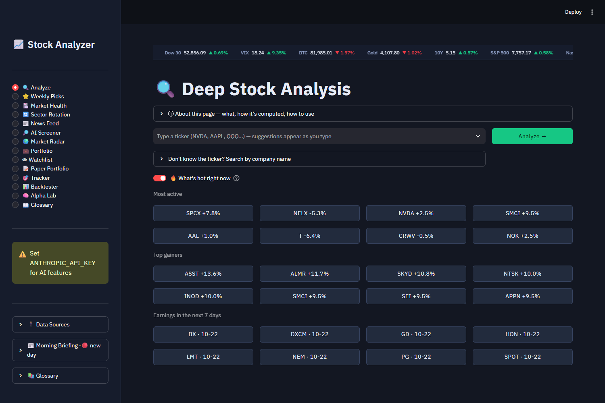
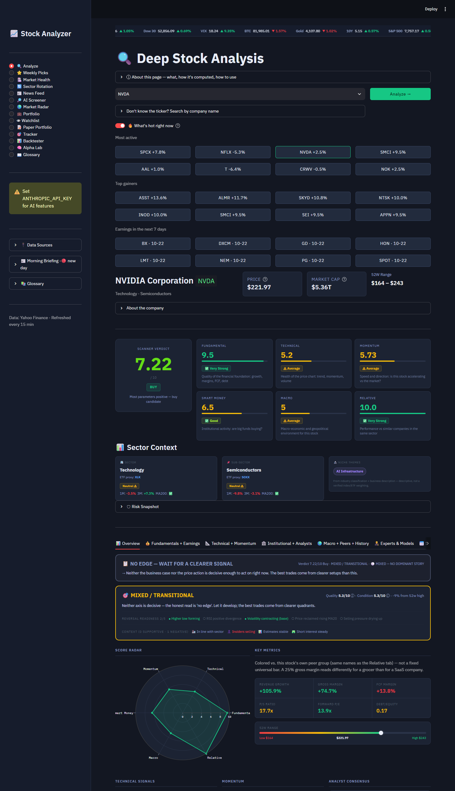
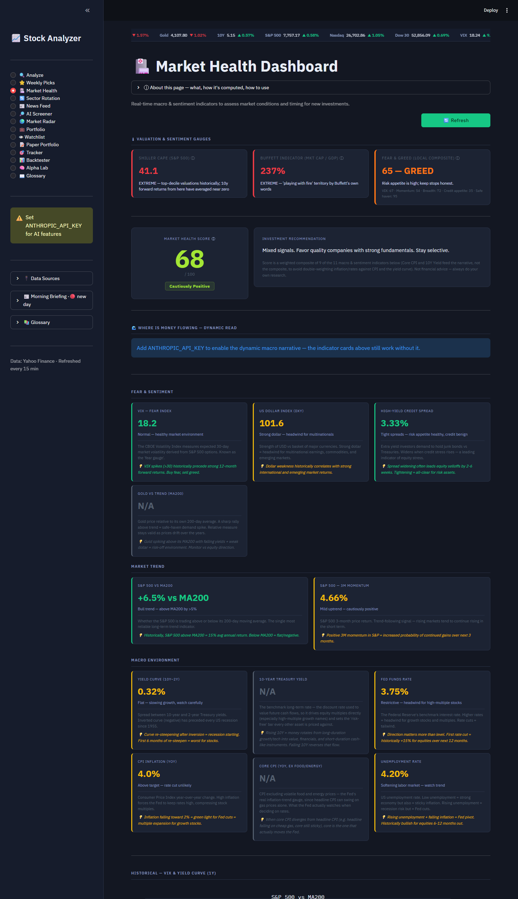
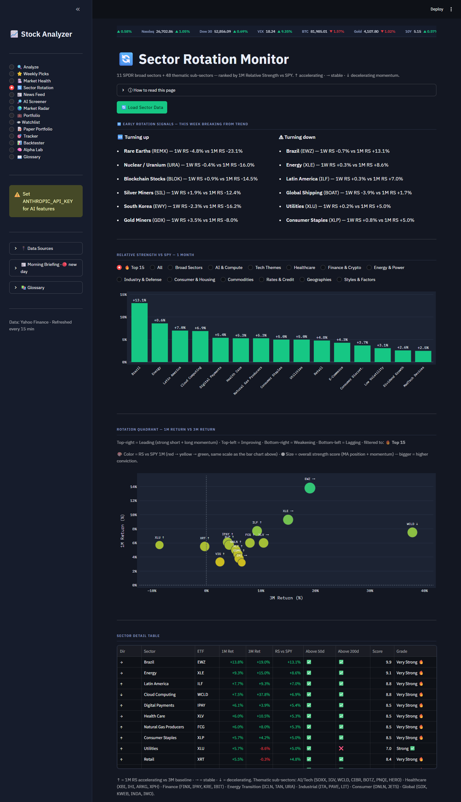

# Investment Analysis Dashboard

A growth-focused stock & ETF research tool built with Python and Streamlit. Combines market data, fundamentals, technicals, and macro context into a single interactive dashboard, with an AI-assisted screener and expert-panel view powered by the Claude API.

> Personal research project — not financial advice.

## Features

- **Fundamental & technical analysis** — scoring, momentum, seasonality, risk metrics
- **Sector & market context** — sector strength/comparison, market health, macro/geo impact
- **Institutional & insider data** — SEC 13F filings, institutional holdings
- **Options & analyst data** — options flow, earnings, analyst estimates (via Finnhub)
- **AI-assisted tools** — AI stock screener and an "expert panel" view using the Anthropic API
- **Agent Mode** — an agentic portfolio builder that uses real Claude tool use: instead of recalling tickers from memory, Claude calls a `get_stock_metrics` tool mid-conversation to pull live price/valuation/momentum data for each candidate before deciding whether to include it
- **Portfolio tools** — paper portfolio simulation, portfolio health checks, price alerts, backtesting
- **Weekly picks** — a recurring screen for candidate ideas

## Screenshots

Captured from a fresh install with no personal data (free FRED and Finnhub keys; the AI features
that need an Anthropic key are not shown).

**Analyze: ticker autocomplete, "What's hot right now" suggestions, and the full stock verdict**




**Market Health: valuation, sentiment and macro indicators blended into one score**



**Sector Rotation: relative strength of sectors and themes vs the S&P 500**



## Tech stack

Python, Streamlit, pandas, numpy, plotly, yfinance, Finnhub, FRED API, Anthropic API

## Setup

**Requirements:** Python 3.12 or newer (developed and tested on 3.14) and Streamlit 1.66.x
(pinned in `requirements.txt` to the tested range so a future release cannot break the app).

**Get the code:** `git clone https://github.com/royi1383-max/investment-analysis-dashboard.git`
(or **Code → Download ZIP** on GitHub). A step-by-step guide for non-developers is in
[SETUP_FOR_FRIEND.md](SETUP_FOR_FRIEND.md).

**Windows (easiest):** double-click `setup_and_run.bat`. It creates a private Python
environment in `%LOCALAPPDATA%\InvestmentDashboard\venv` (your system Python is not
touched), installs the packages, and opens the dashboard in your browser.

**Manual (any OS):**

```bash
python -m venv .venv
.venv\Scripts\activate          # macOS/Linux: source .venv/bin/activate
pip install -r requirements.txt
cp .env.example .env            # then edit .env (see below)
streamlit run app.py
```

Keep the project folder path short on Windows: some packages have very long file names
and installation can fail past the 260-character path limit.

### Your own keys and details (per user)

Nothing personal ships with this project. Everything user-specific lives in a single local
file, **`.env`**, which you create from `.env.example` and which is git-ignored:

| Variable | What it enables | Required? |
|---|---|---|
| `ANTHROPIC_API_KEY` | Expert Panel, AI Screener, Agent Mode, Macro analysis (paid per use) | optional |
| `FRED_API_KEY` | Market Health: rates, CPI, yield curve (free) | optional |
| `FINNHUB_API_KEY` | Analyst ratings, price targets, insider data (free tier) | optional |
| `ALPHA_VANTAGE_API_KEY` | News sentiment (free tier: 25 requests/day) | optional |
| `FMP_API_KEY` | Analyst rating actions, Congress trades (free tier: 250/day) | optional |
| `SEC_CONTACT_EMAIL` | **Your own email**, sent only to sec.gov in the request header. SEC asks automated clients to identify themselves; used by the 13F Smart Money tracker. | recommended |

Without any keys the dashboard still runs; the features that need a key show a message
instead. Use **your own** keys: sharing someone else's means sharing their quota and,
for Anthropic, their bill. Never commit or send your `.env`.

Your watchlist, paper portfolios and alerts are saved as small `.json` files in the
project folder (git-ignored, so they stay on your machine).

## Security notes and disclaimer

- **Local only.** The server listens on `127.0.0.1`, so other devices on your network
  cannot open it. Keys are read from `.env` and sent only to the services listed above.
- **About `unsafe_allow_html`.** The interface builds many styled cards and tables as HTML
  and renders them with Streamlit's `unsafe_allow_html=True` (about 200 places). That flag
  tells Streamlit to insert the text as raw HTML instead of escaping it. **Risk:** if text
  from an outside source (a news headline, a ticker typed by a user, an API response)
  contained HTML or script tags and reached one of those places unescaped, it would run in
  your browser session on this page (cross-site scripting, XSS). **Mitigation here:** the
  app runs only on your own computer, news headlines and links are escaped (links must be http/https) and
  most other outside text goes through `html.escape`, and no keys are held in the browser. The remaining risk is low
  but not zero: do not expose this app to the internet or a shared network, and do not
  paste untrusted text into its input fields.
- **Not investment advice.** Scores, AI opinions and valuations are research aids built on
  assumptions you can change. Data comes mostly from Yahoo Finance and is delayed.

## Project structure

- `app.py` — main Streamlit app / page layout
- `modules/` — one module per analysis feature (fundamentals, technicals, momentum, macro, scoring, portfolio, backtesting, etc.)
- `utils/` — shared helpers (data caching)
- `config.py` — tickers, scoring weights, and app configuration
